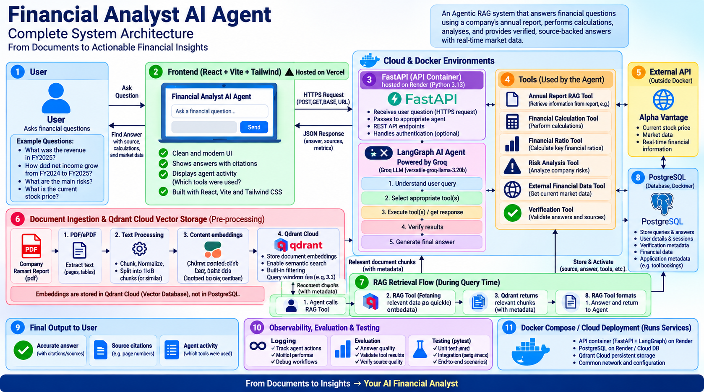

# 🤖 Financial Analyst AI Agent

An **Agentic RAG Financial Analyst AI Agent** built with **LangGraph**, **FastAPI**, **React + Vite**, **Qdrant Cloud**, **Cohere**, and **Groq**. The system answers financial questions grounded in Microsoft's 2025 Annual Report, runs deterministic Python financial calculations and ratio analysis, categorizes risks, fetches external market data, verifies outputs, displays source citations and live step/agent activity in a web UI, and is deployed with a **FastAPI backend on Render (Python 3)** and a **React + Vite frontend on Vercel**.

---

## 🌐 Live Deployment & Health Check

* **Frontend (Vercel):** `https://agentic-rag-financial-analyst-agent.vercel.app` (deployed from the `frontend` directory using the Vite preset with `VITE_API_BASE_URL` pointing to the Render backend)
* **Backend (Render):** `https://agentic-rag-financial-analyst-agent.onrender.com` (deployed as a Web Service on the **Python 3** runtime with build command `pip install -r requirements.txt` and start command `uvicorn app.main:app --host 0.0.0.0 --port $PORT`)
* **Backend Health Check:** `https://agentic-rag-financial-analyst-agent.onrender.com/health` (returns `{"status":"healthy","service":"financial-analyst-agent"}`)

> **Note:** On Render's free instance tier, the backend may spin down after inactivity, so the first request after a pause can take ~30–50 seconds to wake up.

---

## Table of Contents

1. [Project Overview](#1-project-overview)
2. [Why This Is Agentic AI](#2-why-this-is-agentic-ai)
3. [System Architecture & Data Flow](#3-system-architecture--data-flow)
4. [RAG Pipeline, Cohere Embeddings & Qdrant Cloud](#4-rag-pipeline-cohere-embeddings--qdrant-cloud)
5. [Agent Tools & Workflow](#5-agent-tools--workflow)
6. [Backend API & Frontend UI](#6-backend-api--frontend-ui)
7. [Project Structure](#7-project-structure)
8. [Environment Variables](#8-environment-variables)
9. [Running Locally & Cloud Deployment (Render + Vercel)](#9-running-locally--cloud-deployment-render--vercel)
10. [Testing, Evaluation & Observability](#10-testing-evaluation--observability)
11. [Interview Walkthrough](#11-interview-walkthrough)

---

## 1. Project Overview

Instead of routing every prompt through a single static RAG chain, **🤖 Financial Analyst AI Agent** uses a **LangGraph** workflow to interpret the user's question, select the right tool(s), run deterministic math in Python, verify supportability, and return a grounded answer with citations and execution steps.

### Example Questions Supported

* **Annual Report Facts:** *"What was Microsoft's revenue in FY2025?"*
* **Deterministic Growth & Math:** *"How much did Microsoft's revenue grow from FY2024 to FY2025?"*
* **Financial Ratios:** *"What was Microsoft's operating margin in fiscal year 2025?"*
* **Risk Analysis:** *"What are Microsoft's major cybersecurity and operational risks?"*
* **Current Market Data:** *"What is Microsoft's current stock price or market data?"*

---

## 2. Why This Is Agentic AI

| Approach | How It Works |
|---|---|
| **Standard RAG** | Always retrieves chunks and passes them to an LLM |
| **Agent** | Inspects intent, picks actions/tools, and orchestrates steps |
| **Agentic RAG (This Project)** | Combines Qdrant retrieval, Python calculation/ratio/risk/external tools, verification, and citations inside a stateful LangGraph workflow |

> **Key Takeaway:** Retrieval is one tool inside the graph—not the entire application. The agent decides whether to retrieve annual-report chunks, run deterministic calculations or ratio checks, fetch external market data, verify evidence, and format the final response.

---

## 3. System Architecture & Data Flow



### End-to-End Request Flow

```text
User (Browser)
  │
  ▼
React + Vite Frontend (Vercel)
  │  POST /agent/ask (with VITE_API_BASE_URL)
  ▼
FastAPI Backend (Render - Python 3 Runtime)
  │
  ▼
LangGraph StateGraph
  ├── Annual Report RAG Tool ──► Qdrant Cloud (180 indexed chunks)
  ├── Financial Calculation Tool (Deterministic Python arithmetic)
  ├── Financial Ratio Tool (Margins, profitability & leverage metrics)
  ├── Risk Analysis Tool (Structured risk categorization)
  ├── External Financial Data Tool (Live/current market data)
  └── Verification Tool (Evidence & consistency check)
  │
  ▼
Groq LLM (openai/gpt-oss-120b) ──► Grounded Final Response + Citations + Step Status
```

---

## 4. RAG Pipeline, Cohere Embeddings & Qdrant Cloud

1. **PDF Loading & Page-Aware Chunking (`app/rag/pdf_loader.py`, `ingestion.py`, `chunking.py`):** Extracts text page-by-page from Microsoft's 2025 Annual Report so chunks retain document and page metadata for source citations.
2. **Embeddings (`app/rag/embeddings.py`):** Generates vector embeddings using **Cohere** (`embed-v5.0-fast`, configured for 2048-dimensional vectors).
3. **Indexing & Vector Search (`app/rag/indexer.py`, `retriever.py`, `app/database/qdrant.py`):** Indexes chunks into **Qdrant Cloud** (`microsoft_2025_annual_report` collection with 180 indexed chunks) and retrieves top matching passages with page references.

---

## 5. Agent Tools & Workflow

The `app/tools/` package organizes capabilities into focused modules orchestrated by `app/agent/graph.py`, `state.py`, `prompts.py`, and `trace.py`:

* **Annual Report RAG Tool (`rag_tool.py`):** Queries Qdrant Cloud for annual-report evidence and page citations.
* **Financial Calculation Tool (`calculation_tool.py`):** Runs deterministic arithmetic (such as percentage growth, deltas, and differences) in Python rather than relying on LLM mental math.
* **Financial Ratio Tool (`ratio_tool.py`):** Computes financial ratios (such as operating margin and related metrics) from retrieved figures.
* **Risk Analysis Tool (`risk_tool.py`):** Groups and summarizes risk factors (such as cybersecurity, competition, regulatory, privacy, macroeconomic, supply chain, and technology risks) from evidence.
* **External Financial Data Tool (`financial_data_tool.py`):** Retrieves current/external market data separately from historical annual-report facts.
* **Verification Tool (`verification_tool.py`):** Checks evidence presence, calculation consistency, and claim support before finalizing output.

---

## 6. Backend API & Frontend UI

### FastAPI Backend (`app/main.py`, `app/api/routes.py`)

* **`GET /health`:** Health check endpoint returning service status (`{"status":"healthy","service":"financial-analyst-agent"}`).
* **`POST /agent/ask`:** Accepts a user financial query, runs the LangGraph workflow, and returns the answer, citations, and step/tool execution details.
* **CORS Configuration:** Configured in `app/main.py` to allow cross-origin requests from the deployed frontend (including `.vercel.app` origins and optional `ALLOWED_ORIGINS`).

### React + Vite Frontend (`frontend/src/App.jsx`)

* Quick-start example questions for one-click testing.
* Step-by-step execution status indicator showing workflow progress (retrieval, calculation/ratio/analysis, and verification).
* Clean answer rendering with source page citations.

---

## 7. Project Structure

```text
agentic-rag-financial-analyst-agent/
├── app/
│   ├── agent/
│   │   ├── graph.py
│   │   ├── prompts.py
│   │   ├── state.py
│   │   └── trace.py
│   ├── api/
│   │   └── routes.py
│   ├── database/
│   │   ├── postgres.py
│   │   └── qdrant.py
│   ├── llm/
│   │   └── client.py
│   ├── observability/
│   │   └── tracing.py
│   ├── rag/
│   │   ├── chunking.py
│   │   ├── citation.py
│   │   ├── embeddings.py
│   │   ├── indexer.py
│   │   ├── ingestion.py
│   │   ├── pdf_loader.py
│   │   └── retriever.py
│   ├── tools/
│   │   ├── calculation_tool.py
│   │   ├── financial_data_tool.py
│   │   ├── rag_tool.py
│   │   ├── ratio_tool.py
│   │   ├── risk_tool.py
│   │   └── verification_tool.py
│   ├── config.py
│   └── main.py
├── evaluation/
│   ├── dataset.json
│   └── evaluate.py
├── frontend/
│   ├── src/
│   │   ├── App.jsx
│   │   ├── index.css
│   │   └── main.jsx
│   ├── index.html
│   ├── package.json
│   └── vite.config.js
├── tests/
├── docs/
│   └── architecture.png
├── .env.example
├── .gitignore
├── Dockerfile
├── docker-compose.yml
├── FINAL_CHECKLIST.md
├── INTERVIEW_GUIDE.md
└── requirements.txt
```

---

## 8. Environment Variables

Store secrets in `.env` locally (ignored via `.gitignore`) and configure them in your hosting dashboards. Use `.env.example` as a reference.

### Backend Variables (Render)

| Variable | Purpose / Example Value |
|---|---|
| `GROQ_API_KEY` | API key for Groq LLM inference |
| `GROQ_LLM_MODEL` | `openai/gpt-oss-120b` |
| `GROQ_MAX_COMPOSE_EVIDENCE` | `5` |
| `GROQ_MAX_CHUNK_CHARS` | `1200` |
| `COHERE_API_KEY` | API key for Cohere embeddings |
| `COHERE_EMBEDDING_MODEL` | `embed-v5.0-fast` |
| `QDRANT_URL` | Qdrant Cloud cluster endpoint URL |
| `QDRANT_API_KEY` | Qdrant Cloud API key |
| `QDRANT_COLLECTION` | `microsoft_2025_annual_report` |
| `QDRANT_VECTOR_SIZE` | `2048` |
| `ALLOWED_ORIGINS` | *(Optional)* Comma-separated allowed frontend origin(s) |

### Frontend Variables (Vercel)

| Variable | Purpose / Value |
|---|---|
| `VITE_API_BASE_URL` | Live Render backend URL (`https://agentic-rag-financial-analyst-agent.onrender.com`, no trailing slash) |

---

## 9. Running Locally & Cloud Deployment (Render + Vercel)

### Local Development (Backend + Frontend)

1. **Backend:**
   ```powershell
   python -m venv .venv
   .\.venv\Scripts\Activate.ps1
   pip install -r requirements.txt
   uvicorn app.main:app --reload --host 0.0.0.0 --port 8000
   ```
2. **Frontend:**
   ```powershell
   cd frontend
   npm install
   npm run dev
   ```

*(Optional container files `Dockerfile` and `docker-compose.yml` are also included in the repository for local container workflows.)*

### Cloud Deployment

* **Backend on Render:** Deployed as a Web Service using the **Python 3** runtime with build command `pip install -r requirements.txt` and start command `uvicorn app.main:app --host 0.0.0.0 --port $PORT`. Verified at `https://agentic-rag-financial-analyst-agent.onrender.com/health`.
* **Frontend on Vercel:** Deployed from the `frontend` root directory using the **Vite** preset with `VITE_API_BASE_URL` set to `https://agentic-rag-financial-analyst-agent.onrender.com`.

---

## 10. Testing, Evaluation & Observability

* **Automated Tests (`tests/`):** Run the test suite with `python -m pytest -q` to verify routing, tools, RAG, citations, prompts, API routes, and evaluation logic.
* **Evaluation Harness (`evaluation/evaluate.py`, `evaluation/dataset.json`):** Benchmarks end-to-end query handling across financial retrieval, calculations, ratios, risk analysis, and external data scenarios.
* **Observability (`app/observability/tracing.py`):** Supports execution tracing so multi-step agent runs can be inspected and debugged.

---

## 11. Interview Walkthrough

* **Architecture Summary:** Built an Agentic RAG financial assistant using LangGraph for dynamic tool selection, Cohere embeddings with Qdrant Cloud for page-cited annual-report retrieval, deterministic Python tools for calculations and financial ratios, Groq (`openai/gpt-oss-120b`) for synthesis, FastAPI on Render, and React + Vite on Vercel.
* **Why Deterministic Python Tools + Verification:** LLMs should interpret intent and synthesize explanations, while Python handles arithmetic/ratios and a verification step checks grounding before returning answers.
* **Why Separate Vector Search & Relational/External Data:** Vector search handles semantic passage retrieval from filings, while structured/external tools and optional relational storage (`app/database/postgres.py`) handle non-vector application concerns cleanly.